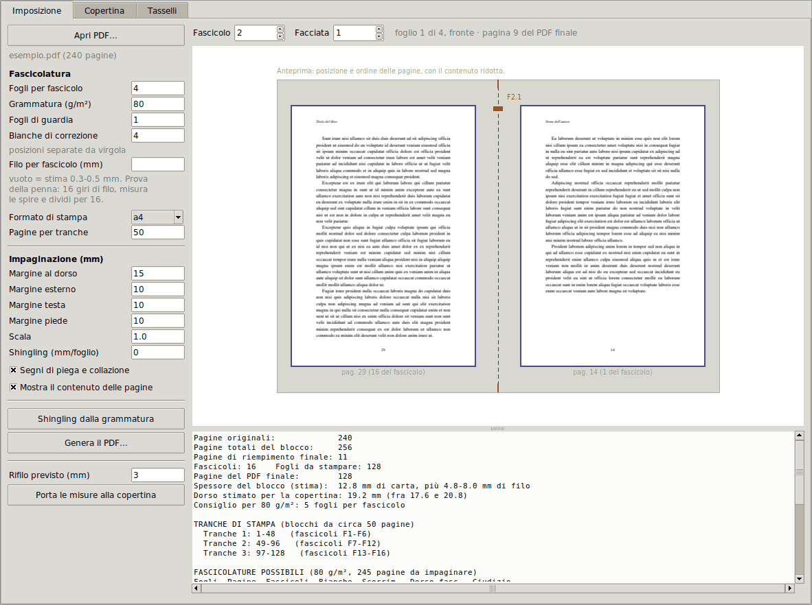
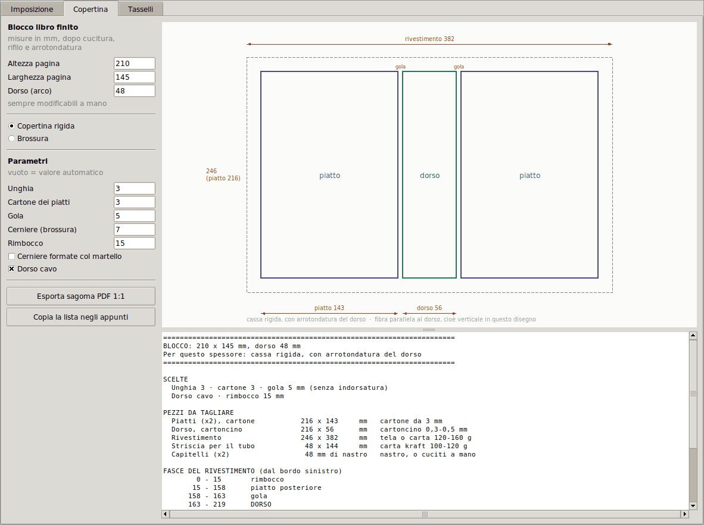
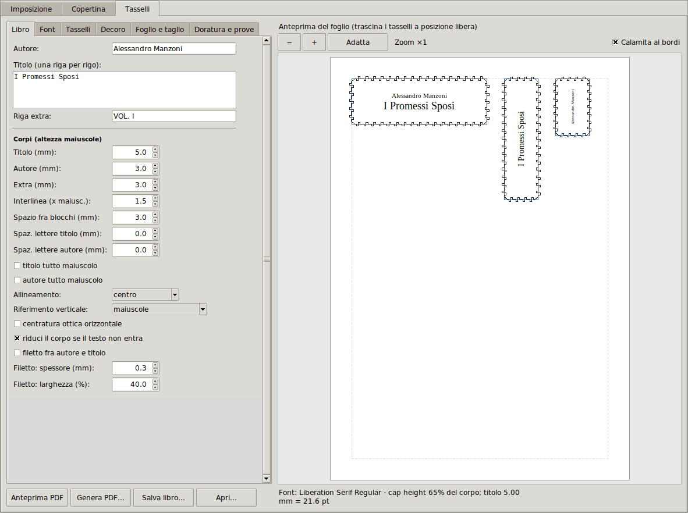

# BBT (Books binding tools) — dal PDF al libro cucito

**BBT** prepara un PDF per farne un libro cucito a mano, in brossura o in copertina rigida: impone le pagine in fascicoli per la stampa fronte/retro, calcola le misure dei pezzi della copertina e compone i tasselli per il piatto e il dorso. È una finestra con tre schede, che seguono l'ordine del lavoro; imposizione e copertina si usano anche da riga di comando, per gli script o per una macchina senza schermo.



Il programma fa solo la parte informatica. Tutto il resto, dalla piegatura alla cucitura, dalle colle alla copertina, sta nel **[manuale di legatoria](docs/manuale.md)**, che si legge anche da solo.

## Installazione

Serve Python 3.9 o più recente e `tkinter`, che serve solo per la finestra e non si installa con pip:

| Sistema | Comando |
| --- | --- |
| Arch / Manjaro | `sudo pacman -S tk` |
| Debian / Ubuntu | `sudo apt install python3-tk python3-venv` |
| Fedora | `sudo dnf install python3-tkinter` |
| Windows / macOS (non supportati, vedi sotto) | incluso nell'installer di Python da python.org (con Homebrew: `brew install python-tk`) |

Poi, dalla cartella del progetto (quella scompattata dallo zip, oppure clonata con `git clone https://github.com/kami-fa-channel/bbt.git`):

```bash
python3 -m venv .venv              # crea un ambiente virtuale
source .venv/bin/activate          # Windows: .venv\Scripts\activate
pip install ".[anteprima]"         # installa il programma e le librerie
bbt                          # apre la finestra
```

L'ambiente virtuale non è un capriccio: le distribuzioni recenti (Arch/Manjaro, Debian 12, Ubuntu 23.04 e successive, Fedora) rifiutano `pip install` fuori da un ambiente virtuale, con l'errore `externally-managed-environment`. Le volte dopo basta attivare l'ambiente (`source .venv/bin/activate`) e lanciare `bbt`; oppure lanciare direttamente `.venv/bin/bbt`, senza attivare niente.

`".[anteprima]"` installa anche `pypdfium2` e `pillow`, che servono a mostrare nell'anteprima il contenuto delle pagine e non solo la loro posizione (se manca `pypdfium2` ma c'è `pdftoppm` di poppler-utils, come quasi sempre su Linux, il contenuto si vede lo stesso, con `pillow`); con `pip install .` si installano solo le librerie indispensabili (`pypdf`, `reportlab`, `fonttools`). Senza installare il pacchetto: `pip install -r requirements.txt` (sempre nell'ambiente virtuale) e poi `python -m legatoria` dalla cartella del progetto.

### Senza ambiente virtuale: `python bbt.py`

Se le librerie sono già disponibili al tuo Python, non serve installare niente: dalla cartella del progetto basta

```bash
python bbt.py                      # apre la finestra (equivale a: python -m legatoria)
python bbt.py copertina -H 210 -L 145 -D 48
```

Su Arch/Manjaro le librerie si installano una volta per tutte con il gestore di pacchetti, senza pip e senza ambiente virtuale:

```bash
sudo pacman -S tk python-pypdf python-reportlab python-fonttools python-pillow
```

(`pypdfium2`, per il contenuto delle pagine nell'anteprima, non è fra questi: senza, l'anteprima usa `pdftoppm` se c'è, altrimenti mostra solo la posizione delle pagine.) Il file non si chiama `legatoria.py` di proposito: accanto alla cartella `legatoria/` un file con lo stesso nome manda in errore `pip install .`.

### Sistemi supportati

Il programma è sviluppato e provato solo su **Linux**, con Python 3.9, 3.12 e 3.13 (Tk 8.6 e 9.0) e con `pypdf` 5.9, 6.7 e 6.19.

**Windows e macOS non sono supportati.** Potrebbe funzionare anche lì, e chi li usa è il benvenuto, ma non c'è modo di provarlo su quelle piattaforme e non si garantisce niente. Un problema specifico di Windows o macOS non si può verificare: se trovi un errore e sai come correggerlo, una pull request è molto più utile di una segnalazione.

Su GitHub i test girano da soli a ogni modifica e a ogni pull request (`.github/workflows/test.yml`). Su Linux è il controllo che conta. Su Windows, su macOS e con Python 3.9 girano come controllo sperimentale: un fallimento lì non blocca niente e non vuol dire che quei sistemi siano supportati, è solo un'informazione in più per chi propone una correzione.

## Uso rapido

1. **Scheda Imposizione.** *Apri PDF…*, guarda il riepilogo (consiglia da solo i fogli per fascicolo secondo la grammatura), sfoglia l'anteprima fascicolo per fascicolo, poi *Genera il PDF…*.
2. **Stampa solo il menabò** (vedi [Riga di comando](#riga-di-comando) e [capitolo 7](docs/manuale.md#7-stampa)), poi il resto a tranches.
3. **Piega, cuci, colla, arrotonda.** Misura il blocco finito.
4. **Scheda Copertina.** Inserisci le tre misure e leggi la lista di taglio; *Esporta sagoma PDF 1:1* se vuoi un riferimento su carta.
5. **Scheda Tasselli.** Titolo, autore, font, misure del dorso; *Genera PDF…* e stampa il foglio dei tasselli ([capitolo 17.2](docs/manuale.md#172-il-tassello)).

Nel passo 1, se hai misurato il tuo filo, indicalo nel campo *Filo per fascicolo* ([capitolo 13](docs/manuale.md#13-cucitura)); poi puoi usare *Porta le misure alla copertina* per avere in anticipo una stima delle tre misure, utile per ordinare cartone e tela prima di aver cucito niente; il [capitolo 16.6](docs/manuale.md#166-le-tre-misure-e-le-formule) spiega quanto fidarsene.

Gli esempi da riga di comando sono più sotto, in [Riga di comando](#riga-di-comando).

## Le tre schede

Tre schede, nell'ordine in cui serve il lavoro: **Imposizione**, **Copertina**, **Tasselli**. Le prime due si passano le misure con il pulsante *Porta le misure alla copertina* ([capitolo 16.6](docs/manuale.md#166-le-tre-misure-e-le-formule)).

Alla chiusura la finestra salva solo lo stato della scheda Tasselli (vedi [Tasselli](#tasselli)). Imposizione e Copertina non salvano niente e alla riapertura ripartono dai valori iniziali: se hai un libro in corso, appunta i parametri usati per l'imposizione.

### Imposizione

A sinistra i campi, a destra l'anteprima dei fogli imposti, in scala, con il contenuto vero delle pagine: le due pagine affiancate, la piega al centro, i margini e, se attivi, i segni. Due viste, da scegliere sopra l'anteprima:

* **Fascicolo intero** (quella di partenza): tutte le facciate del fascicolo, fronte e retro di ogni foglio, così si vede a colpo d'occhio quali pagine del libro finiscono su quale foglio; l'etichetta dice quali pagine del libro contiene il fascicolo. Un clic su una facciata la ingrandisce.
* **Foglio**: una facciata sola, grande; un clic torna al fascicolo.

I contatori *Fascicolo* e *Facciata* scorrono tutto il libro, e lo stesso fa la rotella del mouse sull'anteprima (di fascicolo in fascicolo o di facciata in facciata, secondo la vista). Le pagine si rendono in sottofondo: su un PDF pesante compaiono prima i riquadri con il numero e subito dopo il contenuto. Sotto c'è un riquadro di testo con tre blocchi:

* il **riepilogo** (pagine originali, pagine totali del blocco, pagine di riempimento, numero di fascicoli, fogli da stampare, pagine del PDF finale, spessore stimato del blocco, dorso stimato per la copertina con il suo campo di variazione (un valore solo, se indichi il filo), fogli per fascicolo consigliati per la tua grammatura);
* la **tabella delle tranche** del [capitolo 8](docs/manuale.md#8-stampa-a-tranches-e-formule);
* la **tabella delle fascicolature possibili**, da 1 a 8 fogli, con numero di fascicoli, bianche di riempimento, scorrimento e spessore del fascicolo sulla piega per la tua grammatura, e il valore consigliato in evidenza: è la stessa che stampa `-n` da riga di comando.

Il bordo fra anteprima e riquadro si trascina per dare più spazio all'una o all'altro. Tutto si ricalcola appena cambi un campo. Con *Mostra il contenuto delle pagine* spento l'anteprima mostra solo i riquadri delle pagine con il loro numero.

| Campo | Opzione da riga di comando | Valore iniziale |
| --- | --- | --- |
| Fogli per fascicolo | `-f` | 4 |
| Grammatura (g/m²) | `-w` | 80 |
| Fogli di guardia | `-g` | 0 |
| Bianche di correzione | `-p` (separate da virgola) | nessuna |
| Filo per fascicolo (mm) | `--filo` | vuoto = stima 0,3–0,5 mm |
| Formato di stampa | `--carta` | a4 |
| Pagine per tranche | `-t` | 50 |
| Margine al dorso / esterno / testa / piede | `--margine-dorso`, `--margine-esterno`, `--margine-testa`, `--margine-piede` | 15 / 10 / 10 / 10 mm |
| Scala | `--scala` | 1.0 |
| Shingling (mm/foglio) | `--shingling` | 0 |
| Segni di piega e collazione | `--segni` | **attivo** (da riga di comando è spento) |
| Mostra il contenuto delle pagine | — | attivo se c'è `pillow` e uno fra `pypdfium2` e `pdftoppm` |
| Rifilo previsto (mm) | — | 3, serve solo a *Porta le misure alla copertina* |

Pulsanti: *Apri PDF…*; *Shingling dalla grammatura* ([capitolo 11](docs/manuale.md#11-rifilo-del-taglio-davanti-e-shingling)); *Genera il PDF…*, che propone `<nome>_booklet.pdf`; *Porta le misure alla copertina*.

Due differenze da tenere presenti rispetto alla riga di comando:

* **I fogli per fascicolo non si impostano da soli.** Il campo parte da 4, e il valore consigliato per la tua grammatura compare nel riepilogo (*Consiglio per 80 g/m²: …*) e nella tabella: sei tu a copiarlo nel campo. Da riga di comando, senza `-f`, il programma usa direttamente il consigliato.
* **Le bianche di correzione** si riferiscono, come sempre, al PDF originale ([capitolo 4](docs/manuale.md#4-destra-o-sinistra-la-regola-doro)). Posizioni fuori dall'intervallo del documento vengono ignorate, con un avviso sotto i pulsanti; da riga di comando sono invece un errore.

### Copertina



Calcola le dimensioni di tutti i pezzi della copertina a partire dalle tre misure del blocco finito, applicando le formule dei capitoli [15](docs/manuale.md#15-la-brossura) e [16](docs/manuale.md#16-la-copertina-rigida). La scheda e il sottocomando `copertina` usano la stessa funzione di calcolo, quindi danno gli stessi numeri.

La scheda ha a sinistra i campi, a destra un **disegno in scala** (il rivestimento steso con piatti, gole e dorso quotati per la cassa rigida; la copertina con le quattro cordonature per la brossura) e sotto la **lista dei pezzi da tagliare**, con le fasce del rivestimento o le posizioni delle cordonature.

Il pezzo **"Dorso, cartoncino"** non è largo quanto il dorso: i due piatti restano staccati dal dorso per fare spazio alla gola e alla cerniera, quindi il cartoncino deve coprire anche quello spazio. È largo `dorso + 2 × spessore del cartone` (più 2 mm di gioco se il dorso è cavo): con un dorso da 41 mm e cartone da 3 mm viene 49 mm, non 41. Se il numero sembra sbagliato, è questo il motivo: la formula è nella tabella del [paragrafo 16.6](docs/manuale.md#166-le-tre-misure-e-le-formule) del manuale, il perché nel [16.7](docs/manuale.md#167-il-dorso-cavo).

| Campo | Significato |
| --- | --- |
| Altezza pagina, Larghezza pagina, Dorso (arco) | il blocco **finito**: cucito, collato, rifilato, arrotondato. Il dorso è la misura presa lungo la curva, non in linea retta (paragrafo 16.6 del manuale): se non l'hai ancora misurato, tieni il mouse fermo sul pulsante *Porta le misure alla copertina* per un promemoria. I valori iniziali sono solo un esempio. |
| Copertina rigida / Brossura | quale delle due calcolare |
| Unghia, Cartone dei piatti, Gola | **vuoti = valore automatico**, scelto in base allo spessore del dorso (vedi sotto) |
| Cerniere (brossura) | larghezza delle cerniere francesi, 7 mm |
| Rimbocco | quanto rivestimento si ripiega sul retro del cartone, 15 mm |
| Cerniere formate col martello | l'indorsatura del [capitolo 16.3](docs/manuale.md#163-formazione-delle-cerniere-indorsatura--opzionale): cambia la gola |
| Dorso cavo | il tubo del [capitolo 16.7](docs/manuale.md#167-il-dorso-cavo); attivo di default |

I valori automatici seguono le tabelle del [capitolo 2](docs/manuale.md#2-che-legatura-scegliere) del manuale:

| Dorso | Cartone | Unghia |
| --- | --- | --- |
| sotto i 10 mm | 2 mm | 2,5 mm |
| 10–25 mm | 2,5 mm | 3 mm |
| oltre 25 mm | 3 mm | 3,5 mm |

La gola automatica è il doppio del cartone con un minimo di 6 mm se hai indorsato, una volta e mezza il cartone con un minimo di 4 mm se non l'hai fatto ([capitolo 16.6](docs/manuale.md#166-le-tre-misure-e-le-formule)). Tutti i risultati sono arrotondati al **mezzo millimetro**: sotto non ha senso con una riga e un cutter.

Pulsanti: *Esporta sagoma PDF 1:1* ([capitolo 17.1](docs/manuale.md#171-stampare-direttamente-il-rivestimento); richiede `reportlab`) e *Copia la lista negli appunti*.

### Tasselli



La scheda compone su **un solo foglio PDF** i tasselli di un volume: quello del piatto anteriore (orizzontale), uno o due di dorso (verticali, con il testo ruotato) e un quarto facoltativo. Un libro alla volta. Ogni tassello può contenere autore, titolo e una riga extra, in corpi diversi. I corpi non sono in punti tipografici ma in **altezza delle maiuscole, in millimetri**: un corpo da 5 mm vuol dire maiuscole alte 5 mm, che è la misura che ti serve davvero quando decidi cosa ci sta su un dorso. Il [capitolo 17.2](docs/manuale.md#172-il-tassello) del manuale spiega come usare il foglio, il resto di questa sezione cosa contengono i controlli. La logica sta in `legatoria/tasselli.py`, la scheda in `legatoria/gui/scheda_tasselli.py`.

Il pannello di sinistra ha sei sottoschede scorrevoli; a destra c'è l'anteprima in scala del foglio; sotto i pulsanti.

| Sottoscheda | Cosa regola |
| --- | --- |
| **Libro** | autore, titolo (una riga per rigo), riga extra; altezza delle maiuscole di ciascuno (5, 3 e 3 mm all'inizio); interlinea, spazio fra i blocchi, spaziatura delle lettere; tutto maiuscolo; allineamento; riferimento verticale; centratura ottica; riduzione automatica del corpo se il testo non entra; filetto fra autore e titolo |
| **Font** | famiglia e stile fra i font TrueType di sistema, con un filtro di ricerca; *File font…* per scegliere un file a mano; un taglio diverso a piacere per titolo, autore ed extra. I font `.otf` non sono supportati: la spunta serve solo a mostrarli nell'elenco |
| **Tasselli** | una sotto-scheda per tassello (*Piatto*, *Dorso 1*, *Dorso 2*, *Extra*): se è attivo, larghezza e altezza, raggio degli angoli, margine interno, rotazione, contenuto, scala dei corpi, spazio fra autore e titolo, copie, cornice stampata, base da incollare, ritocco fine X/Y del testo, posizione sul foglio |
| **Decoro** | cornice stampata che viene dorata insieme al testo: filetto semplice, doppio filetto, filetto tratteggiato, angoli incrociati, cantonali, filetto con punti agli angoli, fleuron, bordi continui, cornice bitmap; con i relativi spessori e distanze |
| **Foglio e taglio** | formato (A4, A5, A3, Letter o personalizzato), orientamento, margine, distanza fra tasselli; **serie multiple** da 1 a 4; **bordi di ritaglio** |
| **Doratura e prove** | modalità solo nero, ingrossamento del testo, pagina di prova |

I tasselli iniziali sono un piatto da 95 × 32 mm con autore e titolo, un dorso da 24 × 85 mm con il titolo, un dorso da 24 × 40 mm con l'autore, e un extra da 60 × 20 mm disattivato. **Sono numeri di esempio: adatta la larghezza dei dorsi al tuo libro** ([capitolo 17.2](docs/manuale.md#172-il-tassello)).

Alcune cose non ovvie:

* **Verso di lettura del dorso** ([capitolo 17.4](docs/manuale.md#174-note-tipografiche)): si sceglie con la rotazione. 90° legge dal basso in alto, 270° dall'alto in basso, 180° capovolge; 0° è l'orizzontale del piatto.
* **Posizione libera.** Di default i tasselli si dispongono da soli sul foglio. Togli la spunta a *posizione automatica* e puoi trascinare il tassello con il mouse nell'anteprima, oppure scrivere X e Y in millimetri dal bordo sinistro e superiore. Con più serie in modalità *manuale*, ogni pezzo di ogni serie ha la sua posizione indipendente: spostare una serie non muove le altre.
* **Zoom e allineamento nell'anteprima.** Per posizionare i pezzi con precisione l'anteprima si ingrandisce e i pezzi si agganciano fra loro:
  * **Zoom**: con la rotella del mouse sull'anteprima (attorno al puntatore: il punto che guardi resta fermo), oppure con i pulsanti `−`, `+` e *Adatta* (il foglio intero). Si arriva fino a 60 pixel per millimetro. L'indicazione *Zoom ×N* dice di quanto sei ingrandito rispetto al foglio intero.
  * **Spostare la vista**, quando sei ingrandito: trascina lo sfondo (dove non c'è nessun pezzo), oppure usa il tasto destro o centrale del mouse. La vista non esce mai dal foglio.
  * **Calamita ai bordi** (casella sopra l'anteprima, attiva di partenza): mentre trascini un pezzo, il bordo sinistro, il centro e il bordo destro si agganciano ai bordi e ai centri degli altri pezzi, ai due margini e al centro del foglio, e lo stesso in verticale; compare una linea guida magenta per ogni allineamento. L'aggancio scatta entro 6 pixel dello schermo, quindi **ingrandendo diventa più fine**: a foglio intero serve per allineare in fretta i pezzi, ingrandito per rifinire. Sull'asse agganciato la posizione è esatta, sull'altro resta arrotondata al decimo di millimetro. Tieni premuto **Ctrl** mentre trascini per escluderla al volo, o togli la spunta.
* **Base da incollare.** Con *Base da incollare: sporgenza (mm)* maggiore di zero, ogni tassello attivo genera anche un secondo pezzo, più grande della sporgenza indicata su ogni lato, da incollare sotto il tassello: nell'anteprima si vede come un riquadro grigio con il nome del tassello e "(base)". Non è la *cornice stampata su questo tassello*, che è un'altra opzione e disegna il filetto dentro il tassello. Con il tassello disattivato la base non si vede, ma il valore resta: se compare una base che non ti aspetti, controlla che quel campo sia a 0.
* **Serie multiple.** Ripete l'intero set di tasselli attivi più volte sullo stesso foglio: utile per avere pezzi di scorta o per provare, senza sprecare altri fogli.
* **Bordi di ritaglio.** Sette stili: nessuno, contorno, contorno tratteggiato, crocini agli angoli, contorno con crocini, linee estese, contorno con linee estese. Con *guide su una seconda pagina registrata* le guide vanno su una pagina a parte, in registro con la prima, così non vengono dorate insieme al testo.
* **Spessore e doratura.** Se lo spessore di una cornice o del filetto fra i blocchi scende sotto 0,2 mm, sotto l'anteprima compare un avviso: con la doratura a caldo su un tratto stampato a toner, un tratto così fine rischia di non trasferirsi bene sul foil. Non è un limite imposto, solo un promemoria: si può comunque scegliere uno spessore più fine.
* **Fleuron agli angoli.** Un ornamento più ricco del semplice filetto: due fogliette a forma di mandorla, con nervatura e venature, radicate in ciascuno dei quattro angoli e rivolte verso l'interno, più un piccolo ricciolo. *Dimensione foglie* ne fissa la lunghezza, ma non oltre il punto in cui le foglie di due angoli opposti lungo lo stesso lato arriverebbero a toccarsi. Il ricciolo si può togliere (*fleuron: con il ricciolo*), e si può aggiungere un motivo più piccolo, sempre di due fogliette, al centro dei due lati lunghi (*fleuron: anche al centro dei lati lunghi*). A differenza di un filetto continuo, il centro del tassello resta libero: il testo non deve scostarsi.
* **Bordi decorativi continui.** Tre motivi che corrono lungo tutto il perimetro del tassello, a moduli ripetuti, invece che solo agli angoli o al centro:
  * *Greca continua*: il meandro a chiave greca, un unico tratto ininterrotto. *Larghezza fascia* ne regola lo spessore visivo, *modulo* la lunghezza di ogni elemento ripetuto.
  * *Festone continuo*: una fila di semicerchi concatenati, la pancia rivolta verso l'interno. *Raggio archi* ne fissa la misura.
  * *Dentelli continui*: denti triangolari a zig-zag, la punta verso l'interno. *Altezza denti* e *modulo* ne regolano forma e passo.

  In tutti e tre, *Rientro* fissa la distanza dal bordo del tassello, e il numero di moduli si adatta da solo per farne stare un numero intero su ogni lato, senza lasciarne uno tagliato a metà in un angolo. Usano lo stesso *Spessore filetto* e lo stesso avviso di doratura degli altri modelli, e, come un filetto continuo, fanno scostare il testo dal bordo.
* **Cornice bitmap.** Una cornice composta con i tuoi disegni: il modello *cornice bitmap* prende otto piccoli PNG e li assembla alla misura di ogni tassello, senza ridisegnarli. I file hanno lo stesso nome e un suffisso che dice il ruolo: `ul`, `ur`, `ll`, `lr` (angoli alto/basso, sinistra/destra), `hu`, `hl` (tratto orizzontale in alto e in basso), `vl`, `vr` (tratto verticale a sinistra e a destra), per esempio `cornice1_ul.png`. Con *Scegli…* si indica **uno qualsiasi** degli otto (la finestra si apre sulla cartella `cornici/` del progetto, la libreria, se esiste; si può andare altrove): gli altri si trovano da soli, e se ne manca qualcuno il programma dice quali. Sotto il pulsante compare la misura degli angoli. Serve `pillow`.
  * *Composizione.* I quattro angoli vanno negli angoli, i due tratti orizzontali e i due verticali si ripetono nello spazio fra un angolo e l'altro. *Completa con porzioni di blocchetto* (attivo di partenza) aggiunge un blocchetto in più e lo taglia in modo uguale ai due capi, così il tratto arriva sempre agli angoli; spento, si usano solo blocchetti interi, centrati, e ai capi può restare un po' di vuoto. *Rientro dal bordo* è lo stesso degli altri modelli.
  * *Misura.* I blocchetti non si scalano: la misura stampata è pixel ÷ dpi. I dpi sono quelli scritti nel PNG; se il file non li ha (o sono sbagliati) si forzano con *Risoluzione PNG (dpi)*, e 0 vuol dire "quelli del file", altrimenti 96. A parità di pixel, più dpi vuol dire blocchetti più piccoli: per un tassello da 95 × 32 mm servono angoli di circa 10 mm o meno.
  * *Tasselli piccoli.* Se i due angoli non stanno su un lato, con *se gli angoli non stanno, rimpicciolisci i blocchetti* (attivo) tutti gli otto blocchetti di quel tassello vengono ridotti dello stesso fattore, mai ingranditi; l'avviso sotto l'anteprima dice di quanto. Con la riduzione spenta, gli angoli vengono invece tagliati a metà verso il centro (se è attivo il completamento) oppure la cornice non viene disegnata su quel tassello, e l'avviso lo dice. Il margine del testo segue lo spessore reale della cornice.
  * *Doratura.* Con *solo nero pieno* la trasparenza parziale dei bordi diventa tutto o niente, così il toner non fa grigi. Lo spessore minimo per la doratura non viene controllato: dipende dal disegno.
  * *Creare i blocchetti.* Lo script `estrai_cornice.py`, nella cartella del progetto ma **indipendente da bbt** (si avvia da solo con `python estrai_cornice.py`; serve PyQt5, vedi sotto), parte da un SVG della cornice intera: si sceglie la misura finale in mm e i dpi, si dimensiona il riquadro di selezione **in mm** e lo si posiziona su ciascun pezzo, con un suffisso per ruolo. Scrive i dpi nei PNG, così bbt ne ricava la misura da solo. Per proporre dove salvarli usa la cartella `cornici/` accanto allo script (la crea se manca), che è la libreria delle tue cornici: bbt la apre per prima quando scegli un blocchetto. Per blocchetti più piccoli riduci insieme la misura finale della cornice e quella del riquadro. Dopo aver cambiato mm o dpi l'immagine si rigenera e i blocchi già estratti vengono scartati.
* **Linee estese (per la taglierina).** Prolungano i quattro bordi di ogni pezzo fuori dagli angoli, come un cancelletto (`#`). Lo stile **linee estese** le stampa da sole, cioè il cancelletto *senza il quadretto in mezzo*: solo le squadrette agli angoli, con il bordo del pezzo vuoto; **contorno + linee estese** aggiunge anche il contorno. Nell'anteprima il rettangolo di ogni pezzo è blu solo se il contorno si stampa: senza contorno resta un ingombro grigio, che serve a vedere e trascinare i pezzi ma non compare sul foglio. Servono a chi ritaglia i pezzi grossolanamente e poi li rifila con una taglierina a leva: sul margine di carta che resta si vede un tratto di ciascun bordo, e lo si appoggia alla lama fissa per allinearlo prima del taglio. Ogni linea parte a *distanza* mm dall'angolo ed è lunga *lunghezza* mm (0,5 e 10 di partenza). Sono diverse dai crocini, che restano corti e non si adattano: ogni linea estesa **resta sempre sul margine del proprio pezzo**, cioè si ferma dove sarebbe più vicina a un altro pezzo che al suo (a metà strada, se sono allineati), a 1 mm da un altro pezzo e a 3 mm dal bordo del foglio, dove molte stampanti non stampano. Con la disposizione automatica la *distanza fra tasselli* (e quella fra le serie) sale da sola al minimo che serve, `2 × (distanza + lunghezza) + 0,5` mm: 21,5 mm con i valori di partenza; l'anteprima lo dice. Con le posizioni libere non c'è modo di sapere dove metterai i pezzi, quindi le linee si accorciano dove serve e dopo la generazione compare l'elenco dei pezzi interessati. Di spessore e grigio valgono quelli dei bordi (*Spessore linea*, *Grigio*): per allinearle alla lama conviene un tratto più scuro e deciso del grigio di partenza. Su carta a doratura da toner, con *solo nero pieno* le linee escono nere; per non dorarle usa *guide su una seconda pagina registrata*.
* **Doratura da toner.** *Solo nero pieno* elimina i grigi: il foil si trasferisce solo dove c'è toner pieno. L'*ingrossamento* (0,02–0,08 mm) deposita un po' più di toner e aiuta la presa sui corpi piccoli.
* **Pagina di prova.** Dopo i tasselli aggiunge una o più pagine con il **primo tassello attivo** ripetuto tante volte, con la stessa dimensione e la stessa cornice, ma con il corpo del titolo crescente (da 3 a 7 mm a passi di 0,5 mm, salvo diversa indicazione; autore ed extra seguono in proporzione). Sotto ogni copia c'è scritto il corpo usato. Stampala e dorala prima del libro vero: ti dice qual è il corpo più piccolo che la tua stampante e il tuo foil riescono a rendere.

Pulsanti: *Anteprima PDF* genera un PDF temporaneo e lo apre nel visualizzatore di sistema; *Genera PDF…* lo salva dove vuoi, proponendo come nome il titolo del libro; *Salva libro…* e *Apri…* scrivono e leggono un file `.json` con tutte le impostazioni, uno per volume. Dopo ogni generazione il programma avvisa se il testo non entra in un tassello (*Testo troppo grande in: …*) o se un pezzo esce dal foglio (*Fuori dal foglio: …*).

**Cosa viene salvato da solo.** Nella cartella `.tasselli_legatoria` della tua home, il programma tiene `ultimo_libro.json`, cioè le impostazioni dell'ultima sessione, che riapre da solo all'avvio successivo, e `font_cache.json`, l'elenco dei font, per non rileggerli tutte le volte. Al primo avvio la lettura dei font di sistema richiede qualche secondo e avviene in secondo piano: nel frattempo puoi lavorare.

## Riga di comando

```bash
bbt                          # apre la finestra
bbt imposizione -i libro.pdf ...
bbt copertina ...
bbt imposizione -h           # ogni sottocomando ha il suo aiuto
```

Se non hai installato il pacchetto, scrivi `python bbt.py` (oppure `python -m legatoria`) al posto di `bbt`.

### Sottocomando `imposizione`

```bash
bbt imposizione -i <file.pdf> [-f <fogli_per_fascicolo>] [Opzioni]
```

**Primo passo: chiedi un parere al programma.**

```bash
bbt imposizione -i mio_libro.pdf -w 80 -n
```

`-n` non genera nulla. Legge il PDF, stima lo spessore della carta e stampa una tabella con tutte le fascicolature possibili, il numero di fascicoli che ne deriva, le pagine bianche sprecate, lo scorrimento previsto e lo spessore del dorso di ogni fascicolo, indicando quale valore conviene e quanto lavoro comporta. Nella finestra la stessa tabella compare in fondo al riepilogo, e si aggiorna a ogni modifica dei parametri.

**Secondo passo: genera il file.**

```bash
bbt imposizione -i mio_libro.pdf -f 4 -p 4 --segni
```

**Terzo passo: stampa solo il menabò.**

Le prime `2 × F` pagine del file generato (8 pagine se hai usato `-f 4`). Piegale, sfogliale, controlla che i numeri scorrano e che i capitoli inizino a destra. Solo allora lancia il resto.

Questi sono i parametri principali; gli altri stanno nella tabella qui sotto.

| Par. | Ruolo | Default |
| --- | --- | --- |
| `-i` | **Obbligatorio.** PDF originale. | — |
| `-f` | Numero di **fogli fisici** per fascicolo (1 foglio = 4 pagine). Se omesso viene usato il valore consigliato dal programma. | consigliato |
| `-w` | Grammatura della carta in g/m². Serve solo ai calcoli di consiglio, non tocca il PDF. | `80` |
| `-g` | Numero di **fogli di guardia per lato**, nella carta del testo (1 = 2 facciate bianche davanti e 2 dietro). Vedi il [capitolo 5](docs/manuale.md#5-le-guardie) prima di usarlo. | `0` |
| `-p` | Posizione in cui inserire una pagina bianca di correzione. Ripetibile: `-p 4 -p 120` oppure `-p 4,120`. | nessuna |
| `-t` | Pagine indicative per ogni tranche di stampa. | `50` |
| `-o` | Nome del file finale. | `<nome>_booklet.pdf` |
| `-n` | Solo analisi, nessun file generato. | — |
| `-h` | Aiuto. | — |

#### Altre opzioni

| Opzione | Ruolo | Default |
| --- | --- | --- |
| `--margine-dorso MM` | margine interno, lato piega. È il margine di cucitura: non scendere sotto i 12–15 mm. | `15` |
| `--margine-esterno MM` | margine esterno, lato taglio. Tieni conto dei 3–4 mm che si mangia il rifilo. | `10` |
| `--margine-testa MM`, `--margine-piede MM` | margini superiore e inferiore | `10` |
| `--scala K` | ingrandimento aggiuntivo dopo l'adattamento ai margini. `1.05` sborda un po' e mangia i margini bianchi già presenti nell'originale. | `1.0` |
| `--shingling MM` | compensazione dello scorrimento, in mm per foglio ([capitolo 11](docs/manuale.md#11-rifilo-del-taglio-davanti-e-shingling)) | `0` |
| `--shingling-auto` | stima lo shingling dalla grammatura | — |
| `--segni` | stampa segni di piega, marche di collazione ed etichette | — |
| `--filo MM` | spessore del filo per ogni fascicolo, per esempio misurato con la prova della penna ([capitolo 13](docs/manuale.md#13-cucitura)). Serve solo alla stima dello spessore del blocco: non cambia il file prodotto | stima 0,3–0,5 mm |
| `--carta` | formato del foglio di stampa: `a4`, `a3`, `letter`, `legal` | `a4` |

Gli errori (file mancante, posizione fuori intervallo, margini impossibili, PDF protetto da password, filo non valido) escono con il messaggio `Errore: …` e codice di uscita 1.

#### I segni (`--segni`)

Tre cose, tutte disegnate sulla linea di piega o a ridosso di essa, cioè in quella che dopo la piegatura è la costola del fascicolo. A libro cucito e incollato non si vedono.

* **Tacche di piega** al centro del bordo superiore e inferiore: ti danno il riferimento esatto dove piegare.
* **Marca di collazione**: un rettangolino nero che attraversa la piega, un gradino più in basso a ogni fascicolo. Quando impili i fascicoli piegati vedi una scaletta regolare scendere lungo il dorso: se un gradino salta o si ripete, hai un fascicolo mancante o fuori ordine, e lo vedi in un colpo d'occhio invece che sfogliando.
* **Etichetta** tipo `F12.3` in grigio chiaro accanto alla piega: fascicolo 12, terzo foglio. Sostituisce i post-it colorati del [capitolo 9](docs/manuale.md#9-logistica-post-stampa).

#### Cosa fa il programma, passo per passo

1. Legge numero di pagine e formato del PDF originale.
2. Stampa l'analisi della fascicolatura e sceglie `F`, se non l'hai imposto con `-f`.
3. Costruisce l'elenco delle pagine del blocco:
   `[guardie] [corpo con le bianche di correzione] [riempimento finale] [guardie]`.
4. Per ogni fascicolo calcola l'ordine di imposizione. Per un fascicolo di `S` pagine, il foglio `i` (contato dall'esterno) porta le pagine `S−2i` e `1+2i` sul fronte, `2+2i` e `S−1−2i` sul retro.
5. Piazza ogni pagina nella sua metà di foglio, scalandola per rispettare i margini e spostandola verso il dorso della quantità di shingling prevista per quel foglio.
6. Scrive il PDF e stampa la tabella degli intervalli di stampa.

#### Verificare che tutto torni

Prima di stampare 380 fogli, apri il file generato e controlla la **prima facciata**: deve avere l'ultima pagina del fascicolo a sinistra e la prima a destra (con `-f 4`: pagina 16 a sinistra, pagina 1 a destra). Poi guarda l'ultima facciata del primo fascicolo: deve avere le due pagine centrali affiancate, 8 e 9. Se questi due controlli passano, l'imposizione è corretta. Nella finestra lo stesso controllo si fa sull'anteprima: nella vista *Fascicolo intero* del fascicolo 1, il fronte del foglio 1 e il retro dell'ultimo foglio.

### Sottocomando `copertina`

```bash
bbt copertina                                            # interattivo
bbt copertina -H 210 -L 145 -D 48                        # cassa rigida
bbt copertina -H 210 -L 148 -D 12 --legatura brossura
```

Opzioni: `-u` unghia, `-c` spessore del cartone, `-g` gola, `--indorsato`, `--dorso-incollato`, `--cerniera`, `--rimbocco`. Unghia, cartone e gola, se non li specifichi, vengono scelti in base allo spessore del dorso, come nella tabella qui sopra.

Oltre alla lista di taglio stampa anche le **fasce del rivestimento** misurate dal bordo sinistro, pronte per impostare il file di stampa della copertina ([capitolo 17](docs/manuale.md#17-le-scritte-sulla-copertina)), e le posizioni delle cordonature in caso di brossura.

## Per chi vuole modificare il codice

Il programma e il comando si chiamano `bbt`. La cartella del progetto (qui la chiamiamo `bbt/`, ma il nome non conta) e il pacchetto Python che contiene (`legatoria`, il nome è rimasto quello originale) sono due cose diverse:

```
bbt/                      la cartella del progetto
├── bbt.py                avvio senza installare: python bbt.py
├── estrai_cornice.py     programma a sé (PyQt5): prepara i blocchetti PNG della cornice bitmap
├── cornici/              la libreria delle cornici (PNG), vuota nel repository: estrai_cornice.py ci salva, bbt ci cerca
├── pyproject.toml        installazione: pip install .
├── README.md, docs/, tests/, tools/
└── legatoria/            il pacchetto Python (import legatoria, python -m legatoria)
```

Il pacchetto ha la logica separata dall'interfaccia:

| Modulo | Cosa fa |
| --- | --- |
| `legatoria/imposizione.py` | imposizione a fascicoli: analisi, blocco libro, segni di piega, scrittura del PDF |
| `legatoria/copertina.py` | misure dei pezzi della copertina e sagoma PDF |
| `legatoria/tasselli.py` | composizione dei tasselli: font, disposizione, doratura |
| `legatoria/gui/` | la finestra: una scheda per ciascuno dei tre moduli precedenti |
| `legatoria/cli.py` | la riga di comando |

Le dipendenze sono `pypdf` (imposizione), `reportlab` e `fonttools` (tasselli e sagoma PDF), `tkinter` (solo la finestra) e, facoltativi, `pypdfium2` e `pillow` per l'anteprima con il contenuto delle pagine (`pillow` serve anche alla cornice bitmap) e `PyQt5` e `numpy` solo per `estrai_cornice.py`, che è un programma a sé e non fa parte del pacchetto (`pip install ".[cornice]"` installa anche lui le librerie che gli servono). Se `reportlab` manca la finestra parte lo stesso: la scheda Tasselli mostra un avviso al posto dei controlli e le altre due funzionano normalmente (dalla scheda Copertina non si potrà però esportare la sagoma PDF).

I moduli `imposizione`, `copertina` e `tasselli` non stampano e non chiedono niente: le funzioni restituiscono dati (elenchi, dizionari, oggetti semplici) e sono la finestra e la riga di comando a presentarli, ciascuna a modo suo. È il motivo per cui la tabella delle fascicolature compare uguale nei due posti: viene da una sola funzione, `tabella_fascicolature()`. Gli errori di dati sono `ErroreLegatoria`, con un messaggio già pronto per l'utente. Le ipotesi sul mondo fisico sono costanti con nome, in un posto solo: per esempio `FILO_MM_PER_FASCICOLO` in `imposizione.py` (quanto ingrossa il dorso il filo di ogni fascicolo, con nel commento da dove viene e nel manuale il ragionamento completo), che usano sia il riepilogo sia la stima delle misure per la copertina. Un test controlla che il manuale ([capitolo 13](docs/manuale.md#13-cucitura), il rigonfiamento del filo) dichiari lo stesso intervallo del programma.

I test stanno in `tests/`:

```bash
pip install ".[test]"
pytest                    # la finestra si prova solo se c'è un display
xvfb-run pytest           # su Linux senza schermo, per provare anche la finestra
```

Alcuni test non provano il programma ma la coerenza del progetto: `requirements.txt` e `pyproject.toml` devono elencare le stesse librerie, ogni sottocartella del pacchetto deve essere in `pyproject.toml` (altrimenti manca dopo `pip install .`), e la versione minima di Python deve essere la stessa in `pyproject.toml`, nel README e nel workflow di GitHub.

Nei test automatici di GitHub i test della finestra sono obbligatori (`LEGATORIA_GUI_OBBLIGATORIA=1`): se manca `tkinter` o il display falliscono invece di saltare, per non dare un falso verde.

Le schermate di questo README si rigenerano con `tools/genera_schermate.py` (servono un display, `pillow` e `pypdfium2`; le istruzioni sono nell'intestazione dello script).

## Manuale

Il [manuale di legatoria](docs/manuale.md) spiega la parte manuale del lavoro, ed è scritto perché si possa seguire anche senza il programma:

Per una copia stampabile, `docs/genera_pdf.sh` lo converte in PDF (richiede `pandoc` e una distribuzione LaTeX con `xelatex`, non fra le dipendenze del programma: le istruzioni per installarle sono nell'intestazione dello script). Se manca il font Caladea usa Liberation Serif al suo posto, con un avviso.

1. [Vocabolario](docs/manuale.md#1-vocabolario)
2. [Che legatura scegliere](docs/manuale.md#2-che-legatura-scegliere)
3. [Quanti fogli mettere in un fascicolo](docs/manuale.md#3-quanti-fogli-mettere-in-un-fascicolo)
4. [Destra o sinistra: la regola d'oro](docs/manuale.md#4-destra-o-sinistra-la-regola-doro)
5. [Le guardie](docs/manuale.md#5-le-guardie)
6. [Carta e direzione della fibra](docs/manuale.md#6-carta-e-direzione-della-fibra)
7. [Stampa](docs/manuale.md#7-stampa)
8. [Stampa a tranches e formule](docs/manuale.md#8-stampa-a-tranches-e-formule)
9. [Logistica post-stampa](docs/manuale.md#9-logistica-post-stampa)
10. [Piegatura e pressatura](docs/manuale.md#10-piegatura-e-pressatura)
11. [Rifilo del taglio davanti e shingling](docs/manuale.md#11-rifilo-del-taglio-davanti-e-shingling)
12. [Foratura](docs/manuale.md#12-foratura)
13. [Cucitura](docs/manuale.md#13-cucitura)
14. [Colle](docs/manuale.md#14-colle)
15. [La brossura](docs/manuale.md#15-la-brossura)
16. [La copertina rigida](docs/manuale.md#16-la-copertina-rigida)
17. [Le scritte sulla copertina](docs/manuale.md#17-le-scritte-sulla-copertina)

## Licenza

MIT, vedi il file [`LICENSE`](LICENSE).
